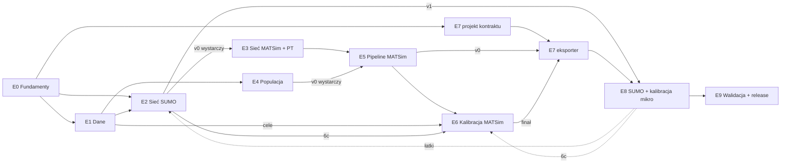

# Roadmapa budowy Digital Twina Wrocławia (MATSim → SUMO)

Plan wysokopoziomowy: major etapy, zależności, czasy, kamienie milowe i ścieżki awaryjne.
Rozbicie na pojedyncze taski jest poza zakresem tego dokumentu.

Podstawa: notatki Fazy 1 (`_analysis/notes/*.md`), porównanie Fazy 2 (`_analysis/comparison.md`), `_analysis/calibration.md`, `_analysis/asc.md`. Odwołania typu „mB”, „eqF” to skróty repozytoriów z `comparison.md`.

**Zakres.** Celem jest środowisko symulacyjne możliwie wierne rzeczywistości. Optymalizacja sygnalizacji (RL) jest odłożona. Trzeba jednak pamiętać o jednym: **obecne programy sygnalizacji są częścią dokładności twina**, nie częścią optymalizacji. Jeśli SUMO dostanie programy zgadnięte przez `netconvert`, kalibracja popytu będzie kompensować błędy przepustowości skrzyżowań, a późniejszy baseline dla RL będzie fałszywy.

---

## 0. Architektura w jednym akapicie

```
 dane lokalne (KBR, OD komórkowe, ZDiUM, GPS, GTFS, OSM, GUS)
        │
        ├──► [E2] sieć kanoniczna SUMO ──► [E3] sieć MATSim (te same ID) + PT
        │                                          │
        ├──► [E4] populacja syntetyczna ───────────┤
        │                                          ▼
        │                               [E5] pipeline MATSim ──► [E6] kalibracja MATSim
        │                                                               │
        │                                                               ▼
        │                                  [E7] artefakt popytu (kontrakt MATSim → SUMO)
        │                                                               │
        └──► liczniki, prędkości, TLS ─────────────────► [E8] scenariusz SUMO + kalibracja mikro
                                                                        │
                                                                        ▼
                                                        [E9] walidacja końcowa + release twina
```

MATSim jest **generatorem popytu w równowadze**: agenci z łańcuchami aktywności, wybór trybu i trasy. SUMO jest **mikrosymulacją**: pasy, skrzyżowania, sygnalizacja, docelowo środowisko RL. Most między nimi to wersjonowany artefakt popytu (E7). Wszystko pod spodem (E0) zapewnia, że da się to odtworzyć.

---

## 1. Etapy

Każdy etap ma ten sam układ:
- **Na czym polega**: opis dla kogoś, kto robi to pierwszy raz.
- **Bazujemy na**: konkretne repozytoria referencyjne i wzorce z nich.
- **Zależy od / zasila**: relacje z innymi etapami.
- **Czas**: czas kalendarzowy. Założenie: 1–3 osoby na etap, praca w niepełnym wymiarze (studenci MSc + koło). Pierwszy projekt tego typu, więc przyjmuj górną granicę widełek.
- **Kamień milowy**: weryfikowalny stan, który kończy etap.
- **Pivot**: co robimy, jeśli nie zdążymy.

---

### E0. Fundamenty: decyzje, środowisko, proweniencja, kryteria dokładności

**Na czym polega.** Zanim powstanie pierwszy plik sieci, trzeba ustalić „zasady gry”. Bez tego 15 osób wyprodukuje niekompatybilne kawałki. Obejmuje to cztery rzeczy:
1. **Decyzje architektoniczne (ADR w `docs/decyzje/`)** dla napięć z `comparison.md` §4:
   - orkiestrator (synpp / Make / własne CLI z manifestami);
   - gdzie żyje kod Java MATSim;
   - zależność GPL (`matsim-tools`);
   - sieć SUMO-first (rekomendowane, patrz E2/E3);
   - **obszar badania**: sam Wrocław czy aglomeracja z dojazdami. To decyzja o skali całego projektu: dojeżdżający spoza miasta generują istotną część ruchu na wlotach.
2. **Środowisko przypięte wersjami:**
   - workspace `uv` z root `pyproject.toml` (dziś go brak);
   - przypięta wersja SUMO (`eclipse-sumo`/`sumolib` z PyPI albo obraz Dockera z tagiem, nie `latest`);
   - przypięta wersja JDK i MATSim;
   - wymagania sprzętowe: MATSim 10–25% dla ~1 mln osób to 32–64 GB RAM na bieg. Kalibracja to dziesiątki biegów, więc trzeba sprawdzić dostęp do klastra.
3. **Proweniencja:** wspólny format manifestu (`meta.json`) dla każdego artefaktu. Zawiera:
   - commit i flagę dirty;
   - wersje narzędzi;
   - hashe wejść;
   - seed i próbkę;
   - licencje źródeł.
4. **Kryteria akceptacji dokładności**: liczby, przy których uznamy twin za „wystarczająco dokładny”. Ustalone **teraz**, bo inaczej kalibracja nigdy się nie skończy. Propozycje startowe do dyskusji:
   - udziały modalne: ±2–3 p.p. względem KBR 2024;
   - natężenia: GEH < 5 na ≥ 85% punktów pomiarowych ZDiUM;
   - czasy przejazdu na korytarzach: ±15% względem GPS na ≥ 85% odcinków.

**Bazujemy na:**
- eqF: `meta.json` (`documentation/meta_output.py`), syntetyczne fixtury danych zastrzeżonych (`tests/testdata.py`), złote hashe determinizmu (`tests/test_determinism.py`);
- mT: licencje per rodzaj artefaktu (`README.md:51-60`), uzasadnienie „duże pliki poza git”;
- mB/mT: `git describe` w JAR. Antywzorzec: wersja w 4 miejscach;
- gro: antywzorzec nieprzypiętych wersji (`ubuntu:latest`, OSM `-latest`).

**Zależy od:** nic. **Zasila:** wszystkie etapy.

**Czas:** 3–5 tygodni. Część (CI, fixtury, manifest) dojrzewa równolegle z E1–E2.

**Kamień milowy M0 „Gotowy warsztat”:**
- ADR-y dla orkiestratora, Javy, sieci, obszaru i licencji zmergowane;
- `uv sync` + przypięte SUMO/JDK działają na maszynach zespołu i w CI;
- zdefiniowany schemat `meta.json`;
- dokument kryteriów dokładności zatwierdzony przez zespół.

**Pivot:** jeśli decyzja o orkiestratorze się przeciąga, bierzemy Make lub numerowane skrypty, ale każdy etap zapisuje manifest (hash wejść + config + commit) i sprawdza go przy wznowieniu (lekcja z gro `run.sh:91-99`). Wymiana orkiestratora później jest tania, brak manifestów nie.

---

### E1. Inwentaryzacja i przygotowanie danych

**Na czym polega.** Każde źródło danych dostaje kartę w `docs/dane/` (pochodzenie, licencja, zasięg czasowy i przestrzenny, znane błędy) oraz stage czyszczący `raw/ → interim/ → processed/` do jednolitego schematu. Kluczowe zbiory i ich rola:

| Źródło | Do czego służy | Etap-konsument |
|---|---|---|
| KBR 2018 / 2024 | łańcuchy aktywności, udziały modalne (cele kalibracji), rozkłady czasów i odległości | E4, E6 |
| OD z sieci komórkowej | rozkład przestrzenny (dom–praca, dojazdy spoza miasta) | E4, E6 (walidacja) |
| GUS / spis / BDL | marginesy populacji: wiek, płeć, gospodarstwa per rejon | E4 |
| OSM | sieć, POI (lokalizacje aktywności) | E2, E4 |
| GTFS (MPK Wrocław) | rozkład jazdy PT, tramwaje i autobusy w SUMO | E3, E8 |
| GIS ZDiUM: sterowniki, detektory, pętle | programy sygnalizacji, lokalizacje detektorów | E2, E8 |
| Pomiary natężeń ZDiUM | cele kalibracji i walidacji natężeń | E6, E8, E9 |
| Prędkości GPS | walidacja czasów przejazdu, prędkości swobodnych | E3/E6, E8, E9 |

Jedna decyzja jest tu nieoczywista: **wybór „dnia referencyjnego”**. Typowy dzień roboczy w konkretnym okresie, do którego dopasowujemy GTFS, liczniki i GPS. Trzymamy go w jednym miejscu konfiguracji (sBe powiela datę w 3 plikach).

**Bazujemy na:**
- eqF: alias `hts` + `check()` dla wyboru ankiety (`data/hts/selected.py`, `data/hts/hts.py:245`), wzorzec dla KBR 2018 vs 2024;
- mPT: adaptery ankiet do wspólnego schematu z wagami (`scenariogen/data/__init__.py:342-417`);
- eqSP: przestroga o gubieniu wag ankiety i zapisie do `raw/`;
- gro: `exceptions.xml` z atrybutem `reason` dla ręcznych poprawek danych.

**Zależy od:** E0 (schematy, układ katalogów). **Zasila:** E2, E4, E6, E8.

**Czas:** 4–8 tygodni na pierwszą wersję wszystkich zbiorów. Potem etap ciągły. Największe ryzyko to **czas uzyskania danych od ZDiUM i operatora komórkowego**, nie praca techniczna.

**Kamień milowy M1 „Dane gotowe do użycia”:**
- każdy zbiór ma kartę w `docs/dane/` i stage produkujący `processed/` w ustalonym schemacie;
- dla zbiorów zastrzeżonych istnieje syntetyczny odpowiednik do CI (wzorzec eqF);
- wybrany i udokumentowany dzień referencyjny.

**Pivot:**
- dane ZDiUM się opóźniają → E2 i E4 jadą na OSM + GTFS + KBR, sygnalizacja tymczasowo z `netconvert --tls.guess`, a kalibracja natężeń przesuwa się na koniec;
- brak OD komórkowego → rozkład przestrzenny z KBR (eqSP pokazuje, że OD da się budować z ankiety).

---

### E2. Sieć kanoniczna SUMO (OSM → SUMO)

**Na czym polega.** Budowa sieci drogowej, na której będzie jeździć mikrosymulacja. To najbardziej „rzemieślnicza” część twina: automatyczna konwersja z OSM daje sieć, która *działa*, ale ma błędy, które psują dokładność. Do poprawienia są:
- liczba pasów i relacje skrętne;
- ograniczenia skrętów;
- sklejanie skrzyżowań (`--junctions.join`);
- typy dróg;
- torowiska tramwajowe przecinające jezdnie.

Kroki koncepcyjne:
1. **Zamrożony snapshot OSM** z datą i hashem w manifeście. „Latest” pobieramy tylko jawną akcją.
2. **`netconvert` sterowany natywnym plikiem `.netccfg`** + `*.typ.xml`, a nie opcjami zaszytymi w skrypcie.
3. **Łatki (`netpatch/`)** jako pliki plain-XML reaplikowane automatycznie przy każdej regeneracji. Nigdy nie edytujemy sieci ręcznie w netedit bez zapisu łatki (antywzorzec sBe `Doerpfeldstr`).
4. **Sygnalizacja z danych ZDiUM:** programy stałoczasowe lub akomodacyjne importowane jako `tllogic` (np. `tls_csvSignalGroups.py` z tabel grup sygnałowych).
5. **Detektory** z geobazy ZDiUM jako osobna warstwa `*.add.xml`, zmapowana na krawędzie i pasy. Opcjonalnie E2 przy TLS (`generateTLSE2Detectors.py`) pod przyszłe RL.
6. **Walidacja automatyczna:**
   - spójność sieci (`netcheck.py`);
   - wszystkie referencje (detektory, TLS, punkty pomiarowe) wskazują istniejące krawędzie;
   - wymagania konsumenta RL: ID bez `_`, konwencja nazw E2 (stsc `static_features.py:194`).
   ID typu `<osm_way>#<n>` dryfują po regeneracji (sBe `build.py:29-63`), więc referencje trzymamy w geo i mapujemy przy budowie.

**Bazujemy na:**
- sBe: snapshot + `netpatch/berlin.netccfg` + łatki kluczowane ID OSM; `NOTES.md` per podscenariusz;
- sSc: `brunswick/miv/build.sh` (łańcuch `netconvert → tls_csvSignalGroups.py → netconvert → gtfs2pt.py`), detektory i TLS jako osobne warstwy;
- mB `Makefile:60-120`: łańcuch osmosis → `netconvert` z opcjami pod MATSim;
- gro: przestroga o spinaniu ID przez heurystyki (`routing.py:411-437`).

**Zależy od:** E0, E1 (OSM od razu; dane ZDiUM dla wersji v1). **Zasila:** E3 (sieć MATSim jest pochodną), E8, pośrednio E6.

**Czas:**
- v0 (automatyczna sieć całego obszaru, TLS zgadnięte): 2–3 tygodnie;
- v1 (łatki kluczowych korytarzy, TLS i detektory ZDiUM): kolejne 6–10 tygodni.

To etap z najdłuższym ogonem: poprawki sieci ciągną się do końca kalibracji w E8.

**Kamienie milowe:**
- **M2a „Sieć v0”:** sieć całego obszaru budowana jednym poleceniem ze snapshotu; przechodzi `netcheck`; puste `sumo -c` startuje.
- **M2b „Sieć v1”:**
  - programy sygnalizacji ZDiUM dla obszaru rdzeniowego;
  - detektory zmapowane, z testem referencji;
  - tramwaje i autobusy z GTFS (`gtfs2pt.py`);
  - sieć wersjonowana i hashowana.

**Pivot:**
- Ręczna praca nad siecią nie mieści się w czasie → **dokładność warstwowa**: pełna jakość (łatki, prawdziwe TLS, detektory) tylko w obszarze rdzeniowym, czyli korytarzach i skrzyżowaniach, które docelowo będą sterowane przez RL. Reszta sieci zostaje automatyczna.
- Import TLS z danych ZDiUM jest zbyt pracochłonny → ręczne przepisanie programów dla 10–30 kluczowych skrzyżowań. Reszta na `--tls.guess` z dostrojonymi długościami cykli.

---

### E3. Sieć MATSim jako pochodna sieci SUMO + komunikacja zbiorowa

**Na czym polega.** MATSim potrzebuje własnej, prostszej sieci (linki z przepustowością i prędkością swobodną) oraz rozkładu jazdy PT (`transitSchedule`). Kluczowa decyzja to wariant **SUMO-first**: sieć MATSim generujemy *z* sieci SUMO z zachowaniem tych samych ID. Dzięki temu trasa wyliczona przez MATSim jest wprost listą krawędzi SUMO, a wyniki SUMO mogą kalibrować przepustowości MATSim (E6c). Alternatywa (pt2matsim osobno z OSM, jak eqF/eqSP) daje dwie niespójne sieci i konieczność heurystycznego mapowania.

Do zrobienia:
- konwersja `network-from-sumo`: kod w matsim-libs `contrib/application`, poza refs;
- uważne potraktowanie `--junctions.join`, `--no-internal-links` i `--remove-turn-restrictions`, które różnicują topologię manewrów (`comparison.md` §5);
- GTFS → `transitSchedule` + `transitVehicles`;
- test „każde ID linku MATSim istnieje w sieci SUMO o hashu X”.

**Bazujemy na:**
- mB `Makefile:60-120` i mT `Makefile:58-74` (wzorzec SUMO-first; `linkGeometries.csv`, `network-ft.csv.gz` jako pliki boczne);
- mPT `features.py:11-18` (założenie edge id == link id);
- eqF `matsim/scenario/supply/gtfs.py` (filtrowanie GTFS do jednego dnia).

**Zależy od:** E2 (wystarczy v0, żeby zacząć). **Zasila:** E5, E6, E7.

**Czas:** 2–4 tygodnie na pierwszą wersję. Potem regeneracja przy każdej wersji sieci SUMO, automatyczna, jeśli E0 zrobione dobrze.

**Kamień milowy M3 „Sieć MATSim zgodna z SUMO”:** sieć MATSim + schedule PT generowane automatycznie z sieci SUMO, z testem zgodności ID; MATSim wczytuje sieć i routuje losowe pary punktów.

**Pivot:** konwerter `network-from-sumo` sprawia problemy → pt2matsim z OSM + jawny plik mapowania link → edge budowany geometrycznie i walidowany testem. Konsekwencja: w E7 przechodzimy na wariant geo-tripów (patrz E7).

---

### E4. Populacja syntetyczna i popyt początkowy

**Na czym polega.** Tworzymy „sztucznych mieszkańców”: gospodarstwa domowe i osoby z atrybutami (wiek, zatrudnienie, posiadanie auta, bilet okresowy), każda z **dziennym planem aktywności** (dom → praca → zakupy → dom) z lokalizacjami i godzinami. To serce modelu agentowego i najbardziej czasochłonny etap metodologicznie. Podetapy:
1. **Populacja bazowa:** osoby i gospodarstwa zgodne z marginesami GUS per rejon (IPF / próbkowanie ważone).
2. **Łańcuchy aktywności** przypisane z ankiety KBR (dopasowanie statystyczne, np. hot-deck po atrybutach).
3. **Lokalizacje pierwszorzędne** (dom, praca, szkoła): rozkład z OD komórkowego / KBR.
4. **Lokalizacje drugorzędne** (zakupy, rekreacja): z POI OSM, z rozkładem odległości z KBR.
5. **Ruch zewnętrzny i dojazdy spoza obszaru:** agenci z kordonu, zależnie od decyzji o obszarze w E0. Opcjonalnie ruch towarowy jako osobna subpopulacja.
6. **Eksport do MATSim** (`population.xml`, `households`, `facilities`, `vehicles`) z próbką jako parametrem (1% / 10% / 25%).

Od początku robimy dwie wersje: KBR 2018 i KBR 2024 jako warianty wybierane w konfiguracji, nie jako kopie kodu.

**Bazujemy na:**
- eqF: cały pipeline syntezy (synpp stages: census → hts → hot-deck → primary/secondary locations → MATSim writers), alias `hts`;
- eqSP: dowód, że adaptacja do nowego kraju skupia się w 4 miejscach (parser spisu, parser ankiety, źródło OD, źródło lokalizacji), a rdzeń przeżywa prawie bez zmian;
- synpp: orkiestracja (uwaga na błąd diamentu `pipeline.py:566-567` przy wariantach KBR w jednym przebiegu);
- mB/mT: próbka w nazwie pliku (`-Npct`).

**Zależy od:** E0, E1 (KBR, GUS, OD, POI). Nie zależy od E2/E3 aż do przypisania lokalizacji do linków, które robi MATSim. **Zasila:** E5.

**Czas:**
- v0 (populacja uproszczona, patrz pivot): 2–3 tygodnie;
- v1 (pełna synteza w stylu eqasim): 8–14 tygodni.

**Kamienie milowe:**
- **M4a „Populacja v0”:** dowolnie prosta populacja dla całego obszaru, poprawna dla MATSim; służy walking skeleton (M-SK).
- **M4b „Populacja v1”:**
  - rozkłady atrybutów zgodne z GUS;
  - rozkłady liczby aktywności, godzin wyjazdu i odległości zgodne z KBR (raport porównawczy);
  - warianty KBR 2018/2024 przełączane konfiguracją;
  - deterministyczna przy danym seedzie (test złotych hashy).

**Pivot (w kolejności od najmniej do najbardziej drastycznego):**
1. Pominąć lokalizacje drugorzędne z modelu grawitacyjnego: losowanie z POI w strefie docelowej wg OD z KBR.
2. Zamiast syntezy z marginesów: **rozwinięcie próby KBR wagami** (każdy respondent klonowany proporcjonalnie do wagi, z losowym rozrzuceniem lokalizacji w strefie). Szybkie, zachowuje realistyczne łańcuchy.
3. Popyt **tripowy z macierzy OD** (każda podróż jako niezależny jednoetapowy plan, jak tsc). Tracimy łańcuchy i część sensu MATSim, ale pipeline do SUMO działa dalej.

---

### E5. Pipeline MATSim: pierwszy działający scenariusz

**Na czym polega.** Złożenie wszystkiego w scenariusz MATSim, który przechodzi przez wiele iteracji i osiąga stan stabilny („równowagę”: agenci przestają poprawiać swoje plany). Do zrobienia:
- **Kod Java scenariusza:** projekt Maven na bazie szablonu, z `RunWroclawScenario`, flagą próbki ustawiającą jednocześnie `flowCapacityFactor`, `storageCapacityFactor` i skalę liczników (mB `OpenBerlinScenario.java:53,73-86`);
- **Konfiguracja:** strategie replanningu (zmiana trasy, czasu wyjazdu, trybu: `SubtourModeChoice` albo discrete mode choice eqasim), scoring per tryb, PT przez SwissRailRaptor;
- **Wywołanie z Pythona** przez subprocess z przypiętym JAR-em, z wersją JAR-a w `meta.json` (luka eqF);
- **Skalowanie:** 1% (iteracje deweloperskie, minuty) → 10% (praca) → 25% (finał). Smoke test 1% × 2 iteracje w CI (wzorzec mB/mT);
- **Diagnostyka zbieżności:** wykresy score per iteracja, udział agentów zmieniających plan, natężenia na wybranych linkach między iteracjami.

**Bazujemy na:**
- mT: szablon projektu (Maven, `RunTemplateScenario.java`, Makefile, `calibrate.py` z FIXME);
- mB: dojrzała wersja tego samego (OpenBerlin v6.x);
- eqF `matsim/runtime/eqasim.py`: Java przypięta commitem, budowana i wywoływana z Pythona (jeśli wybierzemy model wyboru trybu eqasim).

**Zależy od:** E3 (sieć + PT), E4 (populacja; v0 wystarczy do startu). **Zasila:** E6, E7.

**Czas:** 4–8 tygodni do stabilnego biegu 10%.

**Kamień milowy M5 „MATSim zbiega się”:** scenariusz 10% całego obszaru przechodzi ≥ 100 iteracji bez awarii, score i udziały modalne stabilizują się w ostatnich ~20% iteracji, a wynik jest odtwarzalny (ten sam seed → te same wyniki). Smoke test 1% w CI.

**Pivot:**
- discrete mode choice eqasim za trudny → standardowy `SubtourModeChoice` + scoring MATSim (jak mT/mB);
- PT symulowane sprawia problemy → PT **teleportowane** (czas z rozkładu prędkości) w pierwszej wersji. Dla twina skupionego na ruchu drogowym to akceptowalne na start;
- brak mocy obliczeniowej → praca na 10% zamiast 25%.

---

### E6. Kalibracja MATSim (popyt)

**Na czym polega.** Dostrajanie parametrów, aż symulacja odtworzy obserwacje. Kolejne poziomy, każdy opcjonalny poza pierwszym:

| Poziom | Co kalibrujemy | Względem czego | Narzędzie (refs) | Priorytet |
|---|---|---|---|---|
| **6a** | ASC per tryb (udziały modalne) | KBR 2024 | mPT `ASCCalibrator` + Optuna; mT `calibrate.py` | **obowiązkowy** |
| **6b** | ASC per przedział odległości / grupa | KBR (udziały × dystans, × wiek) | mPT `ASCDistCalibrator`, `ASCGroupCalibrator`; mB `calibrate_dist.py` | wysoki |
| **6c** | przepustowość i prędkość swobodna linków MATSim | mikrosymulacje SUMO + GPS | mPT `scenariogen/network/` (aktualne), mB `capacity/` (relikt) | średni |
| **6d** | natężenia na linkach | liczniki ZDiUM | mB `RunCountOptimization` (OptaPlanner) lub Cadyts (`RunOpenBerlinCalibration.java`) | średni |

Szczegóły mechaniki ASC: `_analysis/asc.md`. Przepływ pętli: `_analysis/calibration.md` §5.

Uwagi:
- **6c łączy sieć z kalibracją** i wymaga wspólnych ID (SUMO-first z E3). Dzięki niej popyt MATSim jest zgodny z tym, co SUMO faktycznie przepuści. To bezpośrednio zmniejsza rozjazd na granicy E7/E8.
- Każdy krok pętli 6a to pełny bieg MATSim (100–150 iteracji). Berlin potrzebował 4–10 zewnętrznych iteracji, więc **moc obliczeniowa jest tu wąskim gardłem**, nie kod.
- Pętle kalibracyjne wypadają poza DAG orkiestratora we wszystkich refs (`comparison.md` §1). Trzeba to zaplanować jawnie: parametry wynikowe są wersjonowanym wejściem kolejnego przebiegu.

**Zależy od:** E5; E1 (cele); E2/E3 dla 6c. **Zasila:** E7.

**Czas:**
- 6a: 3–5 tygodni (głównie czas obliczeń);
- 6b: +2–4 tygodnie;
- 6c i 6d: po 4–8 tygodni każdy. Mogą iść równolegle z 6b, prowadzone przez inne osoby.

**Kamienie milowe:**
- **M6a „Udziały modalne skalibrowane”:** MAE udziałów modalnych < 3 p.p. (próg z testu mPT) dla wariantu KBR 2024; parametry zapisane jako wersjonowany plik.
- **M6b „Popyt skalibrowany”:** spełnione kryteria z E0 dla udziałów i rozkładów odległości; natężenia MATSim na punktach ZDiUM w ustalonym progu GEH (jeśli zrobione 6c/6d).

**Pivot:** 6a jest minimum, które musi powstać. 6b–6d odcinamy od końca: najpierw 6d, potem 6c, potem 6b. Brak 6c/6d oznacza, że dopasowanie natężeń przenosi się do SUMO (E8, `routeSampler`). Nie jest to idealne, ale to standardowa praktyka.

---

### E7. Kontrakt i eksport artefaktu popytu (MATSim → SUMO)

**Na czym polega.** Zdefiniowanie i implementacja „mostu”: wersjonowanego artefaktu, który MATSim produkuje, a SUMO konsumuje. To etap mały kodowo, ale gęsty w decyzje. Refs pokazują, że **wszystko, czego kontrakt nie powie jawnie, ginie** (`comparison.md` §6). Kontrakt musi rozstrzygnąć:
- **Trasy vs geo:**
  - trasy 1:1 z MATSim (wymaga SUMO-first, zachowuje równowagę MATSim);
  - geo-tripy routowane przez SUMO (odporne na zmiany sieci, ale SUMO szuka własnej równowagi).

  Rekomendacja do ADR: artefakt niesie **oba**. Trasy na krawędziach + współrzędne O/D. Takiego wariantu nie ma w refs, ale łączy zalety mB i tsc.
- **Plany:** tylko wybrane (`selected`). Importer SUMO bierze `plan[0]` (`matsim_importPlans.py:148`).
- **Czas:** jawny czas odjazdu każdego legu, okno symulacji, warm-up, przesunięcia doby.
- **Tryby:** mapowanie tryb → `vType`/`vClass`; polityka `ride` (osobny pojazd czy pasażer); PT (pomijamy agentów PT w SUMO, bo autobusy i tramwaje jadą z GTFS w E2).
- **Skala:** kto skaluje próbkę 10–25% do 100%. Jedyny dowód w refs to klonowanie w importerze z oznaczeniem w ID i jitterem (tsc `t2s.py:481-537`).
- **Manifest:** hash sieci, dla której artefakt jest ważny; próbka; seed; wersje; licencje.
- **Raport strat konwersji:** ilu agentów, legów i tras odrzucono i dlaczego (wzorzec gro `unrouted_trips.log`).

**Bazujemy na:**
- sumo (imp): `tools/import/matsim/matsim_importPlans.py` i jego 11 fixtur golden-file, które są źródłem prawdy o zachowaniu importera;
- tsc: płaska tabela tripów w geo (`constants.py:25-63`), `edgemapper.py`, klonowanie;
- sSc: konsument ładujący tripy + rerouting (`brunswick`);
- stsc: wymagania konsumenta RL (`<vehicle>` z `<route edges>`, pełna skala, sieć jako twarda część kontraktu);
- mPT: golden-file round-trip writera (`tests/test_MatsimPlansWriter.py`).

**Zależy od:**
- projekt kontraktu: tylko od E0, więc może i powinien startować wcześnie;
- implementacja v0: od dowolnego wyjścia MATSim (nawet z M4a/M5 na 1%);
- wersja finalna: od E6.

**Zasila:** E8.

**Czas:** projekt 2–3 tygodnie; eksporter + testy 3–5 tygodni.

**Kamień milowy M7 „Artefakt v1”:**
- kontrakt w `docs/decyzje/`;
- eksporter z testami golden-file na syntetycznych fixturach;
- artefakt z kalibrowanego MATSim zawiera manifest z hashem sieci;
- test „wszystkie krawędzie w trasach istnieją w sieci o tym hashu” przechodzi;
- raport strat < ustalonego progu.

**Pivot:**
- Własny eksporter się opóźnia → `matsim_importPlans.py` z pre-filtrem planów do `selected` i jawnymi czasami (obejście znanych błędów), potem `duarouter --repair` jako krok kontrolny z raportem.
- Trasy 1:1 nie działają (np. pivot w E3) → tylko geo-tripy + `duarouter`/`duaIterate.py` po stronie SUMO.

---

### E8. Scenariusz SUMO i kalibracja mikroskopowa

**Na czym polega.** Złożenie samowystarczalnego scenariusza SUMO z sieci (E2), popytu (E7) i warstw dodatkowych (TLS, detektory, PT z GTFS), uruchomienie go w pełnej skali i doprowadzenie do realistycznego zachowania. Typowe problemy przy pierwszym uruchomieniu miasta:
- **gridlock** (zakleszczenia na skrzyżowaniach);
- masowe teleportacje pojazdów;
- nierealistyczne kolejki z powodu błędów pasów lub sygnalizacji.

Ich naprawa to iteracja: łatka sieci w E2 → regeneracja → ponowny bieg. Następnie:
- **dopasowanie do natężeń:** porównanie z detektorami ZDiUM. Jeśli trzeba, korekta tras przez `routeSampler.py`, przy zachowaniu popytu MATSim jako bazy;
- **dopasowanie prędkości i czasów przejazdu** do GPS: parametry modelu kierowcy (`vType`: `tau`, `sigma`, `speedFactor`);
- **porównanie MATSim ↔ SUMO:** skimy czasów przejazdu OD z obu symulatorów (wzorzec tsc `s2t_miv.py:214-284`, u nas jako walidacja, nie pętla zwrotna). Duży rozjazd oznacza, że SUMO nie odtwarza równowagi MATSim → wracamy do E6c;
- **benchmark popytu:** wzorzec Wildau, czyli jedna sieć, jedne liczniki i wymienny `route-files`. Porównujemy nasz popyt MATSim z baselinami (`routeSampler` z samych liczników, `randomTrips`). Wynik to mocny argument do publikacji.

**Bazujemy na:**
- sSc: Wildau (benchmark metod popytu; uwaga na błąd w `rms.py:28`), `brunswick` (oneshot/meso), smoke test `sumo --end N` + test „każdy plik z `.sumocfg` istnieje”;
- sBe: `Doerpfeldstr` (routeSampler + liczniki) i `NOTES.md` z wnioskami kalibracji;
- tsc: skimy OD jako miara spójności;
- stsc: wymagania RL (wyjścia poza katalogiem scenariusza, artefakt tylko do odczytu).

**Zależy od:** E2 (v1), E7. **Zasila:** E9; zwrotnie E2 (łatki) i E6 (6c).

**Czas:** 6–10 tygodni. Etap iteracyjny z E2, przeplatany z nim.

**Kamień milowy M8 „SUMO realistyczne”:**
- scenariusz pełnej doby (lub szczytów) dla obszaru przebiega bez gridlocków;
- teleportacje poniżej ustalonego progu;
- kryteria GEH i czasów przejazdu z E0 spełnione w obszarze rdzeniowym;
- raport benchmarku vs baseliny.

**Pivot (od najmniej do najbardziej drastycznego):**
1. Symulacja tylko szczytów (np. 6:00–10:00, 14:00–18:00) zamiast całej doby.
2. **Podobszar:** MATSim dla całego miasta, SUMO tylko dla obszaru rdzeniowego. Trasy przycinamy do granicy przez `tools/route/cutRoutes.py`. To bardzo częsta i w pełni uzasadniona architektura twina pod sterowanie sygnalizacją.
3. Mezoskopowy SUMO (`--mesosim`) poza obszarem rdzeniowym.
4. `routeSampler` dominuje nad popytem MATSim w obszarze rdzeniowym. Tracimy część „agentowości” w SUMO, ale zachowujemy realizm natężeń.

---

### E9. Walidacja końcowa, pakietowanie i release twina v1.0

**Na czym polega.** Formalne sprawdzenie twina względem kryteriów z E0, **na danych nieużytych w kalibracji**: inne punkty pomiarowe, inne dni GPS, KBR 2018 jako test wsteczny. Potem wydanie twina jako wersjonowanej, samowystarczalnej paczki:
- sieć;
- popyt (kilka realizacji z różnymi seedami, bo zmienność dla RL pochodzi z plików popytu, nie z seeda — stsc);
- `.sumocfg` ze ścieżkami względnymi;
- manifest;
- licencje per rodzaj artefaktu;
- raport walidacyjny;
- changelog opisujący zmiany danych i metod (wzorzec mB).

**Bazujemy na:**
- mB: CHANGELOG per wersja scenariusza, tabela licencji;
- mT: `CITATION.cff`, licencje per artefakt;
- eqF: release-please, `docs/cases/<miasto>.md`;
- stsc: minimalny kontrakt konsumenta RL (manifest z `tls_id`, liczbą faz, `num_seconds`).

**Zależy od:** E8 (i pośrednio wszystkiego). **Zasila:** przyszłą fazę RL.

**Czas:** 3–5 tygodni.

**Kamień milowy M9 „Twin v1.0”:**
- raport walidacyjny (hold-out) spełnia kryteria z E0 albo jawnie dokumentuje odchylenia;
- paczka uruchamia się `sumo -c` na czystej maszynie;
- test determinizmu (złote hashe) przechodzi;
- release otagowany, z manifestem i changelogiem.

**Pivot:** kryteria nie są spełnione wszędzie → release v1.0 z jawnie opisanym zakresem ważności (np. „skalibrowany dla obszaru rdzeniowego w szczycie porannym”). Dla publikacji i dla RL to wartościowe, o ile jest uczciwie udokumentowane.

---

## 2. Zależności i równoległość



**Ścieżka krytyczna:** E0 → E2 (v0) → E3 → E5 → E6 → E7 → E8 → E9.
E4 (populacja) jest **drugą, prawie równie długą ścieżką** i łączy się z krytyczną w E5. Jeśli E4 v1 się spóźni, staje się krytyczna. To najczęstsze ryzyko harmonogramu w projektach eqasim-podobnych.

**Co może iść równolegle (przydział na osoby/zespoły):**

| Strumień | Etapy | Charakter pracy |
|---|---|---|
| **A. Infrastruktura** | E0 → potem wsparcie CI, manifesty, release | inżynieria oprogramowania |
| **B. Sieć** | E2 → E3 → E6c → wsparcie E8 | GIS, SUMO, dużo pracy ręcznej, dobre dla koła naukowego |
| **C. Popyt** | E1 (KBR, GUS, OD) → E4 | statystyka, ankiety, synteza populacji |
| **D. MATSim** | E5 → E6a/b/d | Java, modelowanie wyboru, obliczenia |
| **E. Most + SUMO** | E7 (projekt od razu) → E8 → E9 | integracja, testy kontraktu, walidacja |

Strumienie B i C nie zależą od siebie aż do E5. To główne źródło równoległości.

### Walking skeleton (kluczowa rekomendacja)

Dla zespołu bez doświadczenia największe ryzyko to **integracja na końcu**: każdy etap działa osobno, a razem nie. Dlatego około **tygodnia 8–10** wszystkie strumienie powinny dostarczyć *najprostszą możliwą* wersję i przepchnąć ją przez cały łańcuch:

**M-SK „Szkielet end-to-end”:**
1. sieć v0 (M2a) i jej pochodna MATSim;
2. populacja v0 (M4a);
3. MATSim 1% × kilka iteracji;
4. eksport v0 (choćby `matsim_importPlans.py`);
5. `sumo -c` startuje i coś jedzie.

Jakość jest nieistotna. Liczy się to, że każdy interfejs między etapami został raz przetestowany prawdziwymi plikami. Od tego momentu każdy strumień podnosi wierność swojego kawałka, a szkielet służy jako test regresji.

---

## 3. Harmonogram orientacyjny

Tygodnie od startu (T0). Widełki są szerokie, bo to pierwszy projekt tego typu. Plan zakłada, że strumienie B, C, D, E mają po 1–3 osoby.

```
Tydzień            0    4    8    12   16   20   24   28   32   36   40   44
E0 Fundamenty      ████▒▒
E1 Dane            ▒███████▒▒▒▒▒▒▒▒▒▒▒▒▒▒▒▒▒▒▒▒ (ciągłe)
E2 Sieć SUMO           ██▒(v0)████████████▒▒▒▒▒▒▒▒▒▒▒▒▒▒▒▒▒▒▒ (łatki z E8)
E3 Sieć MATSim+PT          ████▒▒                (regeneracja automatyczna)
E4 Populacja           ███(v0)████████████▒▒▒
E7 Kontrakt/eksport        ███(projekt)▒▒  ██(v0)       ██████(v1)
E5 Pipeline MATSim             ██████████
E6 Kalibracja MATSim                     ████████████████▒▒▒▒
E8 SUMO + mikro                                    ██████████████▒▒
E9 Walidacja/release                                           ██████
Kamienie milowe    M0   M2a  M-SK M3   M4b  M5   M6a  M7   M6b  M8   M9
                   ~4   ~6   ~10  ~12  ~18  ~20  ~26  ~30  ~32  ~38  ~42
```

█ praca główna, ▒ praca w tle / ogon.

**Łącznie: ok. 9–11 miesięcy do twina v1.0.** Przy starcie w połowie października 2026 daje to okolice lipca–września 2027.
Jeśli terminy prac magisterskich wypadają wcześniej, trzeba **z góry** wybrać, które pivoty planujemy wziąć (patrz §4), zamiast czekać, aż wymusi je kalendarz.

---

## 4. Plan awaryjny jako całość

Pivoty z poszczególnych etapów składają się w trzy spójne „profile ambicji”. Warto zdecydować wcześnie, który jest planem bazowym, a który zapasowym. Każdy z nich nadal daje działający twin.

| Element | **Pełny** (cel) | **Zredukowany** (~7–8 mies.) | **Minimalny** (~5–6 mies.) |
|---|---|---|---|
| Obszar SUMO | całe miasto | całe miasto meso + obszar rdzeniowy micro | tylko obszar rdzeniowy (`cutRoutes.py`) |
| Sieć | łatki + TLS ZDiUM wszędzie, gdzie są dane | jakość tylko w obszarze rdzeniowym | obszar rdzeniowy, TLS przepisane ręcznie |
| Populacja | synteza z marginesów GUS + łańcuchy KBR | rozwinięcie próby KBR wagami | popyt tripowy z OD |
| MATSim | discrete mode choice, PT symulowane, 25% | `SubtourModeChoice`, PT symulowane, 10% | `SubtourModeChoice`, PT teleportowane, 10% |
| Kalibracja MATSim | 6a + 6b + 6c + 6d | 6a + 6b | 6a |
| Dopasowanie natężeń | w MATSim (6c/6d) + kontrola w SUMO | `routeSampler` w SUMO | `routeSampler` w SUMO |
| Artefakt | trasy + geo, własny eksporter | trasy, własny eksporter | `matsim_importPlans.py` + pre-filtr + `duarouter --repair` |
| Okno czasowe | pełna doba | szczyty | jeden szczyt |

**Punkty decyzyjne (go / pivot):**
- **Po M-SK (tydz. ~10):** jeśli szkielet nie działa end-to-end, problem jest w integracji, nie w wierności. Wstrzymujemy prace nad jakością i naprawiamy interfejsy.
- **Po M4b / M5 (tydz. ~20):** jeśli populacja v1 nie jest gotowa, przechodzimy na „rozwinięcie próby KBR wagami” (profil zredukowany dla populacji).
- **Po M6a (tydz. ~26):** ile mocy obliczeniowej realnie mamy. Na tej podstawie decydujemy, czy 6c/6d się zmieszczą, czy natężenia przenosimy do SUMO.
- **W połowie E8 (tydz. ~32):** jeśli pełne miasto w SUMO wciąż ma gridlocki, przechodzimy na podobszar.

**Ryzyka przekrojowe, niezależne od etapu:**
- **Dostęp do danych ZDiUM i OD komórkowego.** Nie da się go przyspieszyć pracą techniczną. Należy go uruchomić w tygodniu 0.
- **Moc obliczeniowa dla kalibracji.** Trzeba ją sprawdzić w E0, a nie w E6.
- **Rotacja ludzi** (koło naukowe, koniec semestru). Chroni przed nią wyłącznie E0: manifesty, testy, karty danych, ADR-y. mT „zgnił” właśnie z braku testów regresyjnych (`README.md:7-8`).
- **Licencje:** GPL/AGPL w eqasim/matsim, dane zastrzeżone. Każdy artefakt publikowany musi mieć tabelę licencji per źródło, zanim wyjdzie poza zespół.
